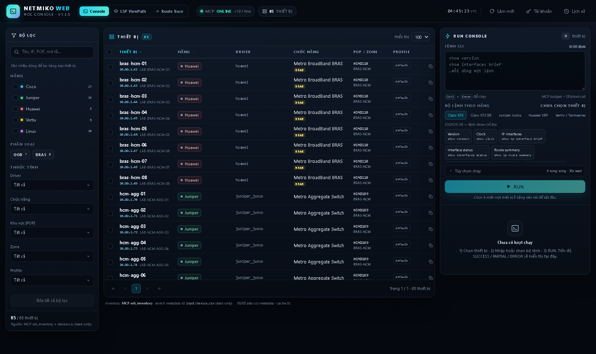
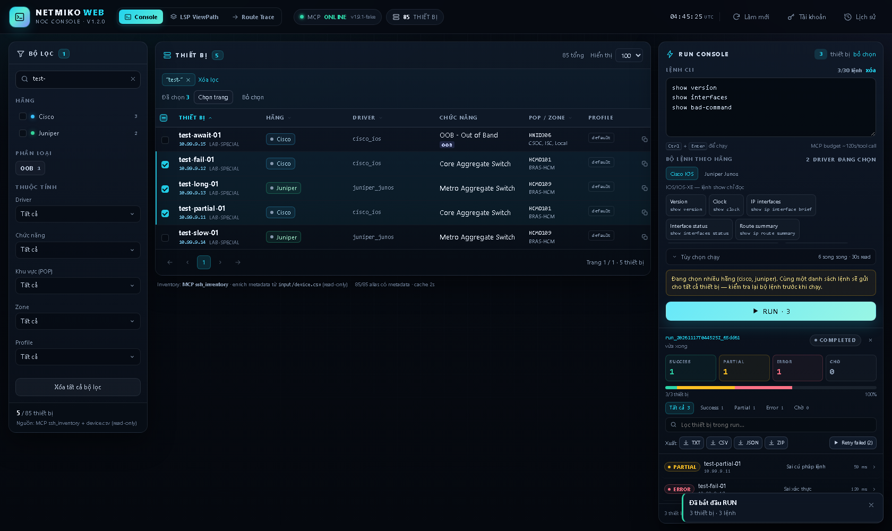
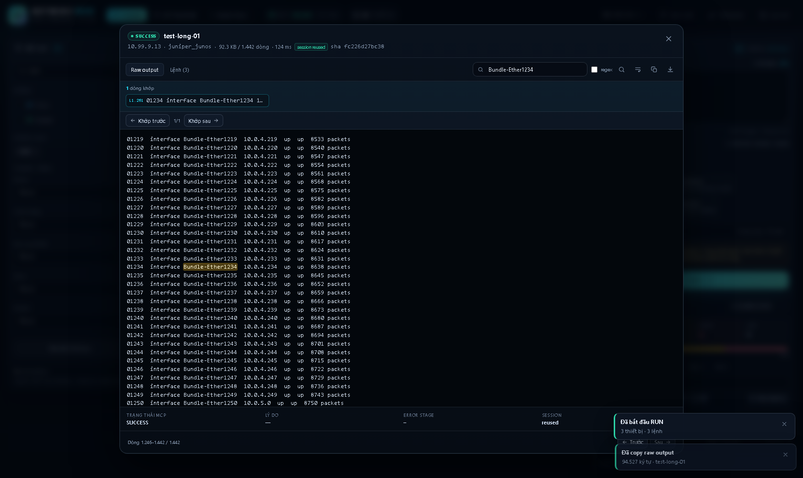

# Netmiko Web Console

NOC Web Console cho phép chọn thiết bị từ inventory của **Netmiko MCP**, nhập lệnh CLI, SSH hàng loạt và theo dõi kết quả `SUCCESS / PARTIAL / ERROR` theo thời gian thực. Giao diện React + TypeScript (dark NOC dashboard), backend FastAPI, chạy bằng một cú nhấp đúp.







## 1. Chạy nhanh

```text
Netmiko-Web-Console\
  START_WINDOWS.bat     <- nhấp đúp để mở Web
  STOP_WINDOWS.bat      <- dừng Web và MCP của nó
```

- Không cần kích hoạt venv, không cần mở hai terminal.
- `START_WINDOWS.bat` chọn cổng trống trong `8787–8800`, khởi động backend ẩn, chờ MCP `ready`, rồi mở trình duyệt tại `http://127.0.0.1:<port>/`.
- Nếu Web đã chạy, nhấp `START` lần nữa chỉ mở lại trình duyệt.
- `STOP_WINDOWS.bat` từ chối dừng nếu còn run đang chạy. Dùng `STOP_WINDOWS.bat -Force` khi thực sự cần.
- Logs: `logs\web-console.log`, `logs\server.out.log`, `logs\server.err.log`, `logs\mcp-stderr.log`.
- Runtime/token/port: `data\runtime.json`.

Yêu cầu máy: Python 3.10+ và cài dependency:

```bat
python -m pip install -r backend\requirements.txt
```

`frontend\dist` đã build sẵn nên không cần Node để chạy. Nếu xóa `dist`, `START` sẽ tự build khi tìm thấy Node.js.

## 2. Kiến trúc MCP (self-contained)

Web Console đóng gói MCP server của chính nó, không phụ thuộc folder/dịch vụ bên ngoài:

```text
config\devices.json       # cấu hình MCP
config\device.csv         # inventory (local, không đưa vào ZIP)
config\credentials.json   # credential riêng của Web (local, không đưa vào ZIP)
vendor\mcp\               # MCP server source
backend\console\mcp_launcher.py
```

- MCP chạy stdio trong process riêng do Web Console quản lý.
- Không viết lại SSH engine; Web chỉ gọi các MCP tools (`ssh_inventory`, `ssh_status`, `ssh_execute_many`, `ssh_read_output`).
- Session pool / autodetect / output reader thuộc instance MCP của Web và được tái sử dụng giữa các lượt RUN.
- Evidence/output nằm trong `data\mcp-outputs`; credential và inventory nằm trong `config\`.
- Bấm pill **MCP ONLINE** trong UI để xem transport, PID, tools, session pool, command line.

Chi tiết đầy đủ: [`docs/MCP-INTEGRATION.md`](docs/MCP-INTEGRATION.md).

### 2.1. Juniper compatibility shim

MCP/Netmiko mặc định gửi 3 lệnh `set cli screen-width/complete-on-space/screen-length` khi mở phiên Junos. Với tài khoản bị giới hạn login class, các lệnh này bị từ chối và run Juniper lỗi ở `preparation`.

Launcher của Web bỏ 3 lệnh này cho MCP của Web, mặc định `NETMIKO_WEB_JUNIPER_PREP=skip`. Đã test thật `show version` thành công trên 2 thiết bị Juniper (ACX7100 Junos EVO và AGG-BRAS). Output có thể wrap ở 80 cột; pager vẫn do MCP reader xử lý. Đặt biến môi trường thành `strict` trước khi START để dùng hành vi gốc. Chi tiết: [docs/JUNIPER-PREPARATION.md](docs/JUNIPER-PREPARATION.md).

## 3. Chức năng

### Inventory & bộ lọc
- Nguồn thiết bị: `ssh_inventory` của MCP (authoritative: alias, IP, driver, profile).
- Enrich metadata từ `config\device.csv` (local): manufacturer, function, POP, zone, rack, mô tả.
- Lọc: Cisco, Juniper, Huawei, Vertiv, Linux, OOB, BRAS, driver, chức năng, POP, zone, profile, tìm kiếm tên/IP/POP/mô tả.
- Phân trang server-side (50/100/200/500), sắp xếp theo tên/host/hãng/driver/POP. Đã kiểm thử với **3.222 thiết bị thật** và 3.085 thiết bị giả lập: chỉ render trang hiện tại, không lag.
- Chọn một/nhiều thiết bị bằng checkbox; chọn cả trang; chọn tất cả theo bộ lọc hiện tại; giữ lựa chọn khi đổi trang/bộ lọc.

### Lệnh & chạy
- Nhập nhiều dòng lệnh (mỗi dòng một lệnh), `Ctrl+Enter` để chạy.
- Bộ lệnh **read-only** theo hãng: Cisco IOS, Cisco XR, Juniper Junos, Huawei VRP, Vertiv/termserver, Linux.
- Cảnh báo khi trộn nhiều hãng trong cùng một danh sách lệnh.
- Xác nhận trước khi chạy lệnh có khả năng thay đổi cấu hình (`configure`, `set`, `delete`, `commit`, `reload`…). Web Console không tự thêm/commit cấu hình.
- Tùy chọn: số worker song song (1–16), read timeout (15–90s), tiếp tục lệnh sau lỗi CLI đã đồng bộ.
- Mỗi thiết bị = một lệnh gọi MCP `ssh_execute_many`; lỗi transport dừng batch của thiết bị đó. MCP `request_timeout` mặc định khoảng 120s/tool call nên UI cảnh báo khi >4 lệnh/thiết bị.

### Theo dõi & bằng chứng
- SSE (`fetch` stream có token header) cập nhật tiến độ real-time; fallback polling nếu SSE lỗi.
- Thẻ tiến độ `SUCCESS / PARTIAL / ERROR / QUEUED / RUNNING`, thanh tiến độ, lọc theo trạng thái, tìm thiết bị trong run.
- `error_reason` / `error_category` / `error_stage` / message lấy từ MCP được hiển thị, kèm gợi ý xử lý (sai xác thực, timeout, pager chờ phản hồi, output chưa đầy đủ…).
- Raw output đầy đủ được lưu riêng cho từng thiết bị (`data/runs/<run_id>/<seq>-<device>.txt` + `.json`), kèm SHA-256.
- Viewer: xem theo trang, bật/tắt wrap, tìm toàn bộ output phía server, nhảy tới dòng khớp, copy toàn bộ raw, tải `.txt`, xem chi tiết từng lệnh.
- Xuất **TXT, CSV, JSON, ZIP**. ZIP gồm `summary.txt`, `summary.csv`, `run.json`, `manifest.json`, `devices/*.txt`, `devices/*.json`.
- Lịch sử run trong SQLite; mở lại run cũ; **Retry failed** chỉ chạy lại thiết bị `ERROR`/`PARTIAL`; **xóa từng run hoặc toàn bộ lịch sử** (chỉ run đã kết thúc) kèm raw evidence tương ứng.
- **Quản lý credential profile** ngay trong Web: xem username/auth type, xem secret có chủ đích, thêm/sửa/xóa profile (profile đang dùng hoặc `default` được bảo vệ), ghi trực tiếp file MCP hiện có. Sau khi lưu cần **Restart MCP** để áp dụng; không copy credential sang data/logs. Chi tiết: [`docs/CREDENTIALS.md`](docs/CREDENTIALS.md).
- Run bị gián đoạn khi Web dừng được đánh dấu `interrupted`/`web_restarted` thay vì báo sai là thành công.
- Giới hạn mặc định: 1.000 thiết bị/lượt, 30 lệnh/lượt, raw tối đa 64 MB/thiết bị (raw lớn hơn vẫn còn trong MCP `output_id`).

### LSP ViewPath (MPLS/RSVP-TE)
Menu **LSP ViewPath** trực quan hóa đường đi MPLS LSP trên mạng Juniper bằng dữ liệu SSH read-only từ MCP:
- Nhập hostname/IP ingress (autocomplete từ inventory) → **Discover LSP** liệt kê LSP configured/operational → chọn LSP → **Trace Path**.
- Parser tách riêng **configured path**, **explicit ERO**, **operational path/RRO**, RSVP session state, standby, no-CSPF, strict/loose hop. Không kết luận operational path từ tên path/cấu hình.
- Xác minh hop theo thứ tự ưu tiên: interface IP của thiết bị đã đọc → inventory → LLDP/IS-IS adjacency. Hop không map được hiển thị bằng IP và `UNRESOLVED`; không tự suy hostname từ mô tả interface.
- Chỉ SSH các node ứng viên từ LLDP/IS-IS/hop IP (mặc định tối đa 8 node), dùng lại session pool MCP, chạy song song có giới hạn. Không quét toàn bộ inventory.
- Primary/SECONDARY ACTIVE: xanh lá nét liền. Secondary/backup standby: vàng/xanh dương nét đứt. DOWN/CONFLICT: đỏ. UNKNOWN/UNVERIFIED: xám nét đứt. Link vật lý chỉ được vẽ khi LLDP/IS-IS xác minh; nếu chỉ có RRO/ERO thì là logical segment `adjacency UNVERIFIED`. LLDP và IS-IS lệch nhau → `CONFLICT`.
- Click node/link để xem interface, IP, bandwidth (nếu có), link status và raw evidence; mỗi evidence lưu device/command/timestamp/SHA-256/file raw.
- Snapshot BEFORE/AFTER, Compare Mode (primary/active/hop added/removed/status changed), ticket plan `PLANNED — NOT APPLIED`.
- Quản lý raw: **Xoá raw** (giữ snapshot), **Xoá snapshot + raw**, **Dọn raw discovery**, **Xoá tất cả**; API tương ứng `/api/lsp/raw/*`, `/api/lsp/snapshots*`.
- Export **JSON/SVG/PNG**; topology hỗ trợ zoom, pan, fit, kéo node.
- API: `/api/lsp/*`; code: `backend/console/lsp/`, `frontend/src/lsp/`. Chi tiết: [`docs/LSP-VIEWPATH.md`](docs/LSP-VIEWPATH.md).

### Route Troubleshooting (Source → Destination)
Menu **Route Trace** điều tra đường đi hai chiều từ Source tới Destination bằng dữ liệu SSH read-only từ MCP:
- Chỉ cần nhập Source/Destination hoặc dán nguyên ticket/nội dung sự cố (tự tách IP); VRF, protocol/port tuỳ chọn. Không đoán thiết bị theo hostname và không quét toàn inventory.
- Kiểm tra forward route (longest-prefix, next-hop, interface, protocol, active/hidden/reject), đi tiếp qua interface/loopback/LLDP đã xác minh, rồi kiểm tra reverse route từ Destination về Source. Không kết luận thông hai chiều chỉ vì forward route tồn tại.
- Kiểm tra VRF/L3VPN (table, label/RD, Import/Export RT), route leak, PBR (`show ip policy`), firewall theo inventory. Không kết luận firewall chặn khi chưa có bằng chứng.
- Ping kiểm chứng chỉ chạy khi người dùng bật `allow_reachability`; TCP/UDP không kiểm thử end-to-end.
- Kết luận tách biệt `ROUTE_EXISTS` / `FORWARDING_VERIFIED` / `REACHABLE` / `BLOCKED` / `UNKNOWN`, kèm mức tin cậy, vị trí nghi ngờ và findings.
- Topology interactive: xanh = đã xác minh, vàng = chưa đủ bằng chứng, đỏ = lỗi, nét đứt = next-hop chưa xác minh; mũi tên thể hiện hướng traffic; click node/link để xem lệnh SHOW và raw output.
- Tiến trình theo từng thiết bị (poll `progress`), Evidence Viewer, Export Report Markdown 4 mục NOC, lưu trace/raw trong `data/routes`.
- API: `/api/route/*`; code: `backend/console/route_trace/`, `frontend/src/route/`. Chi tiết: [`docs/ROUTE-TROUBLESHOOTING.md`](docs/ROUTE-TROUBLESHOOTING.md).

## 4. Kiến trúc

```text
Browser (React 19 + TS, Vite)
   │  fetch JSON + SSE (X-Web-Console-Token)
   ▼
FastAPI (backend/console)
   ├── InventoryService   ssh_inventory + CSV read-only
   ├── RunManager         ssh_execute_many (thread → MCP), classify, SSE
   ├── EvidenceStore       raw output paging/search
   ├── ExportService       TXT/CSV/JSON/ZIP
   ├── HistoryStore        SQLite (WAL) + data/runs
   ├── LspService          Junos MPLS/RSVP parse, hop verify, snapshot, compare
   │     └── topology      evidence-aware nodes/edges (LLDP/IS-IS/RRO)
   ├── RouteTraceService   forward/reverse route, VRF/L3VPN, PBR/firewall evidence
   │     └── topology      forward + reverse lanes, verified/unresolved edges
   └── StdioMCPClient      JSON-RPC over stdin/stdout
            │
            ▼
   backend/console/mcp_launcher.py
      ├─ vendor/mcp/bootstrap.py  (MCP server bundled; config trong config/)
      └─ Juniper prep shim (Web-only, bỏ 3 lệnh set cli terminal)
            │ Netmiko session pool, autodetect, output reader
            ▼
        Thiết bị mạng
```

Không có mã SSH nào trong Web Console. Các MCP tool được dùng:

| Tool | Mục đích |
|---|---|
| `ssh_inventory` | danh sách thiết bị/alias/IP/driver |
| `ssh_status` | session pool, reuse, autodetect, output dir |
| `ssh_execute_many` | chạy danh sách lệnh trên một thiết bị |
| `ssh_read_output` | đọc đầy đủ output đã lưu theo `output_id` |
| `ssh_parallel` | MCP đã hỗ trợ; LSP ViewPath dùng worker có giới hạn qua `ssh_execute_many` + thread, không mở SSH engine mới |

## 5. Cấu hình

Biến môi trường (đặt trước khi chạy, hoặc trong `scripts\start.ps1`):

| Biến | Mặc định | Ý nghĩa |
|---|---|---|
| `NETMIKO_WEB_PORT` | `8787` | cổng ưu tiên (START tự chọn cổng trống) |
| `NETMIKO_WEB_MCP_COMMAND` | launcher + bootstrap + config + CSV + output dir | JSON array hoặc chuỗi lệnh MCP thay thế (dùng cho test/fake MCP) |
| `NETMIKO_WEB_JUNIPER_PREP` | `skip` | `skip` bỏ 3 lệnh `set cli ...` của Juniper cho MCP con; `strict` dùng hành vi gốc Netmiko/MCP |
| `NETMIKO_WEB_MCP_CREDENTIALS` | tự phát hiện | đường dẫn credential JSON dùng cho tab Tài khoản và MCP con; mặc định file MCP/config hiện có |
| `NETMIKO_WEB_INVENTORY_CSV` | `..\input\device.csv` | CSV metadata read-only |
| `NETMIKO_WEB_DATA_DIR` | `.\data` | toàn bộ data Web (history, runs, runtime) |
| `NETMIKO_WEB_LOG_DIR` | `.\logs` | log Web |
| `NETMIKO_WEB_CONCURRENCY` | `6` | worker mặc định |
| `NETMIKO_WEB_MAX_DEVICES` | `1000` | giới hạn thiết bị/lượt |
| `NETMIKO_WEB_KEEP_RUNS` | `200` | số run giữ lại |
| `NETMIKO_WEB_LSP_CACHE_TTL` | `180` | TTL cache discover LSP (giây) |
| `NETMIKO_WEB_LSP_READ_TIMEOUT` | `20` | read timeout mỗi lệnh LSP (5–120s) |
| `NETMIKO_WEB_LSP_TOOL_TIMEOUT` | `145` | ngân sách tối đa một batch LSP; không vượt giới hạn MCP |
| `NETMIKO_WEB_LSP_MAX_NODES` | `12` | số node tối đa được SSH thêm để verify hop |
| `NETMIKO_WEB_DISABLE_TOKEN` | tắt | chỉ dùng khi debug nội bộ, không khuyến nghị |

Chỉ bind `127.0.0.1`. Không đổi host ra `0.0.0.0` nếu chưa có lớp xác thực mạng.

## 6. Bảo mật & phạm vi

- Web Console dùng credential file **riêng** trong `config\credentials.json`; không đọc credential từ project khác. Web không lưu mật khẩu vào data/logs.
- **Quản lý credential** (tab Tài khoản) đọc/ghi trực tiếp file `config\credentials.json`, không copy sang Web data. Danh sách profile chỉ trả username/auth type/usage; muốn xem secret phải bấm rõ ràng và API trả `no-store`. Sau khi lưu cần **Restart MCP** để áp dụng. Profile `default` và profile đang có thiết bị dùng không xóa được.
- Token ngẫu nhiên mỗi lần khởi động, bắt buộc với mọi API (trừ `/api/health`, `/api/bootstrap` phục vụ same-origin). Middleware chặn Host lạ (chống DNS rebinding), chặn framing.
- Lệnh CLI có thể là lệnh cấu hình nếu người dùng nhập; Web chỉ cảnh báo/xác nhận, không tự chạy cấu hình, không tự `commit`/`save`.
- Không tự trả lời câu hỏi pager/xác nhận. Thiết bị `AWAITING_INPUT` được đánh dấu lỗi và hướng dẫn xử lý thủ công.
- Không tự retry lệnh khi kết quả không chắc chắn (`MCPTimeout`, mất kết nối). Dùng “Retry failed” có chủ đích.
- `STOP_WINDOWS.bat` xác minh `instance_id` qua health + token trước khi dừng; chỉ dừng PID Web và MCP con có parent tương ứng.
- Dữ liệu Web nằm trong folder này; `config/`, `data/`, `logs/` là của Web; source/config không bị sửa bởi tiến trình khác.

## 7. Kiểm thử

Tất cả test SSH dùng **MCP giả lập** (`tests/fake_mcp.py`), không kết nối thiết bị production. Inventory thật chỉ được đọc bằng `ssh_inventory` để xác minh tích hợp MCP.

```powershell
cd Netmiko-Web-Console

# Unit + integration (FastAPI TestClient + fake MCP stdio)
python -m pytest tests --ignore=tests/e2e -q

# Playwright (Chrome), fake MCP, screenshot vào evidence/e2e
python -m pytest tests/e2e -q
```

Kết quả lần chạy cuối: **60 unit/integration pass**, **6 Playwright pass**. Chi tiết và phạm vi: [`docs/TESTING.md`](docs/TESTING.md).

Kiểm tra giao diện trên dữ liệu thật (chỉ đọc inventory, không SSH):

- 3.222 thiết bị từ `ssh_inventory`, 5 hãng, 7 driver, OOB/BRAS, 290 POP.
- Trang load không lỗi console, không tràn ngang; bảng chỉ render 100 dòng/trang.
- Metrics: `evidence/real-inventory-metrics.json` (không lưu ảnh/tên/IP thiết bị thật; ảnh UI dùng dữ liệu giả lập trong `evidence/e2e/`).

## 8. Cấu trúc folder

```text
Netmiko-Web-Console/
├─ START_WINDOWS.bat / STOP_WINDOWS.bat
├─ backend/
│  ├─ server.py                 # entrypoint uvicorn (1 process)
│  └─ console/
│     ├─ main.py                # FastAPI, auth, API, static
│     ├─ mcp_client.py          # stdio JSON-RPC client + job object
│     ├─ inventory.py           # ssh_inventory + CSV enrich
│     ├─ runner.py              # scheduling, SSE, classification, evidence
│     ├─ history.py             # SQLite
│     ├─ evidence.py            # raw paging/search
│     ├─ exports.py             # TXT/CSV/JSON/ZIP
│     ├─ lsp/                   # parser Junos, topology builder, evidence/snapshot
│     ├─ settings.py
│     ├─ mcp_launcher.py         # launcher MCP + Juniper shim
│     └─ presets.json
├─ vendor/mcp/                   # MCP server bundled
├─ config/                       # devices.json, device.csv, credentials.json (local)
├─ frontend/
│  ├─ src/…                     # React + TS UI
│  ├─ src/lsp/                  # LSP ViewPath canvas, layout, SVG/PNG export
│  ├─ dist/                     # build sẵn cho one-click
│  └─ package.json
├─ scripts/start.ps1, stop.ps1, build_release.py
├─ tests/                       # fake MCP, unit, integration, e2e
├─ evidence/                    # screenshot Playwright
├─ data/                        # runtime, SQLite, raw runs, MCP outputs
├─ logs/
└─ docs/
```

## 8.1. Đóng gói phát hành (portable)

Bản dev hiện tại đã tự chứa MCP (`vendor\mcp`) và config (`config\`). Gói phát hành loại bỏ credential/inventory/history thật, chỉ giữ template để chia sẻ.

Để phát hành:

```powershell
cd Netmiko-Web-Console
python scripts\build_release.py
```

Kết quả:

```text
dist\release\Netmiko-Web-Console\                         # folder chạy được
dist\release\Netmiko-Web-Console-1.0.0-portable.zip        # gói phát hành
```

Gói portable chứa:

- Web Console + `frontend\dist` (không cần Node để chạy);
- MCP server trong `vendor\mcp\` (không cần dịch vụ MCP bên ngoài);
- `config\devices.json`, `config\device.example.csv`, `config\credentials.example.json`;
- `START_WINDOWS.bat` / `STOP_WINDOWS.bat`, launcher shim Juniper, docs.

Gói **không** chứa credential, `known_hosts`, inventory production, history/raw. Trên máy đích:

1. Cài Python 3.10+ và `python -m pip install -r backend\requirements.txt`.
2. Copy inventory vào `config\device.csv`.
3. Copy `config\credentials.example.json` → `config\credentials.json`, điền credential.
4. Nhấp `START_WINDOWS.bat`.

Đã kiểm thử gói portable từ một folder khác trên máy này: MCP bundled khởi động, đọc inventory, chạy `show version` read-only trên Juniper thành công, output/raw lưu trong `data\` của gói. Chi tiết: [`docs/RELEASE.md`](docs/RELEASE.md).

## 9. Xử lý sự cố

| Hiện tượng | Kiểm tra |
|---|---|
| `START` báo không healthy | xem `logs\server.err.log` / `logs\web-console.log`; kiểm tra Python có `fastapi`, `uvicorn` |
| MCP `ERROR` | mở pill MCP → stderr tail; thử **Restart MCP**; kiểm tra `mcp\devices.json`/credential profile của MCP (không sửa từ Web) |
| Inventory 503 | MCP chưa sẵn sàng; bấm “Thử lại”; kiểm tra `config\device.csv` còn tồn tại |
| Run TIMEOUT hàng loạt | giảm số lệnh/lượt, giảm read timeout, tăng worker hợp lý; xem session pool |
| Juniper `ERROR` ở `preparation`, raw có `set cli screen-width` + `syntax error` | Web mặc định đã bỏ 3 lệnh terminal (xem [docs/JUNIPER-PREPARATION.md](docs/JUNIPER-PREPARATION.md)). Nếu đang đặt `NETMIKO_WEB_JUNIPER_PREP=strict`, bỏ biến này hoặc cấp 3 quyền `set cli ...` cho login class |
| `STOP` từ chối | còn run đang chạy — chờ hoặc `STOP_WINDOWS.bat -Force` |
| Port bận | START tự chọn 8788–8800; URL thật nằm trong `data\runtime.json` và log |

## 10. Giới hạn đã biết

- MCP stdio chạy trong process riêng; session pool không chia sẻ với bất kỳ instance MCP nào khác.
- MCP giới hạn ngân sách mỗi tool call (~120s) và session pool 64; Web không sửa các giới hạn này.
- Juniper mặc định bỏ 3 lệnh terminal để tương thích login class bị giới hạn: output có thể xuống dòng ở 80 cột. Đặt `NETMIKO_WEB_JUNIPER_PREP=strict` nếu tài khoản đã được cấp đủ quyền terminal.
- MCP `continue_on_error` chỉ tiếp tục khi lỗi CLI đã đồng bộ; lỗi transport luôn dừng batch của thiết bị đó.
- Không có multi-user/RBAC; đây là công cụ nội bộ chạy trên loopback.
- CSV chỉ enrich metadata; nếu CSV thiếu alias, thiết bị vẫn hiển thị nhưng không có POP/zone/chức năng.
- CSV/mcp có thể thay đổi trong lúc Web chạy; bấm “Làm mới” để nạp lại inventory.
- LSP ViewPath hiện parse các dạng `show mpls lsp [name] extensive`, `show rsvp session extensive`, `show rsvp interface`, `show isis adjacency`, `show lldp neighbors`, `show interfaces descriptions/terse`, `show configuration ... | display set`. Các biến thể Junos rất cũ/khác format có thể trả `UNVERIFIED` thay vì đoán.
- Hop chỉ được coi là physical link khi LLDP/IS-IS xác minh. RRO/ERO chỉ chứng minh thứ tự path, không chứng minh adjacency; canvas ghi `adjacency UNVERIFIED`.
- Hop IP không map được sẽ hiển thị bằng IP + `UNRESOLVED`; không suy hostname từ description/interface name.
- LLDP và RSVP/IS-IS lệch nhau hiển thị `CONFLICT`; đây là tín hiệu điều tra, không tự sửa.
- LSP ViewPath không đọc/ghi cấu hình, không commit, không đổi LSP; ticket `set/delete` chỉ hiển thị `PLANNED — NOT APPLIED`.
- Chưa kiểm thử trên toàn bộ phiên bản Junos/thiết bị production; test dùng transcript giả lập và fake MCP. Lần xác minh Juniper thật chỉ là `show version` read-only (xem `docs/TESTING.md`).

## 11. Lịch sử thay đổi

- `1.0.0` — bản đầu: inventory/filter, multi-select, presets theo hãng, RUN song song qua MCP, SSE progress, raw viewer/search/copy, export 4 định dạng, history + retry failed, one-click Windows start/stop, test fake MCP + Playwright.
- `1.1.0` — **LSP ViewPath**: Discover/Trace Junos MPLS LSP read-only, parser configured/ERO/RRO/RSVP/LLDP/IS-IS, topology có evidence + UNRESOLVED/CONFLICT, Before/After snapshot + compare, ticket `PLANNED — NOT APPLIED`, export JSON/SVG/PNG, zoom/pan/drag, test parser/API/Playwright.
- `1.2.0` — **Route Troubleshooting**: nhập Source/Destination, tự xác định gateway có giới hạn, forward/reverse route, VRF/L3VPN/RT, route leak, PBR/firewall evidence, ping tuỳ chọn, topology forward/reverse clickable, evidence viewer và báo cáo NOC 4 mục; test parser/API/Playwright với fake MCP.
